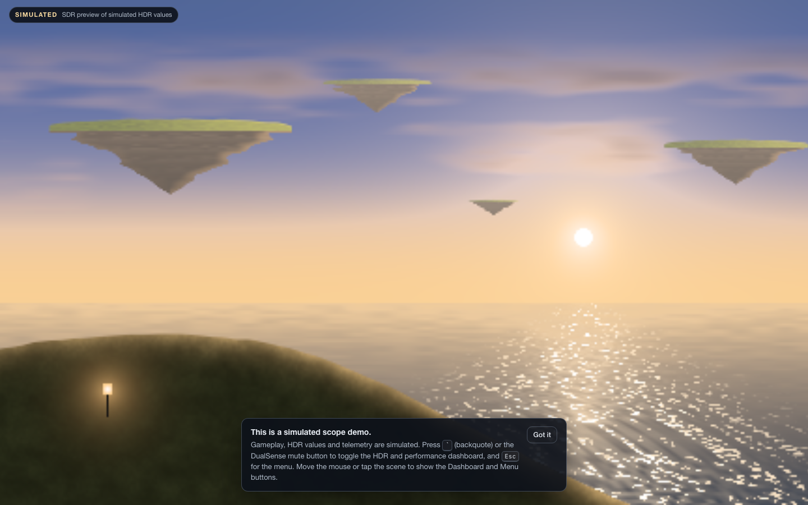
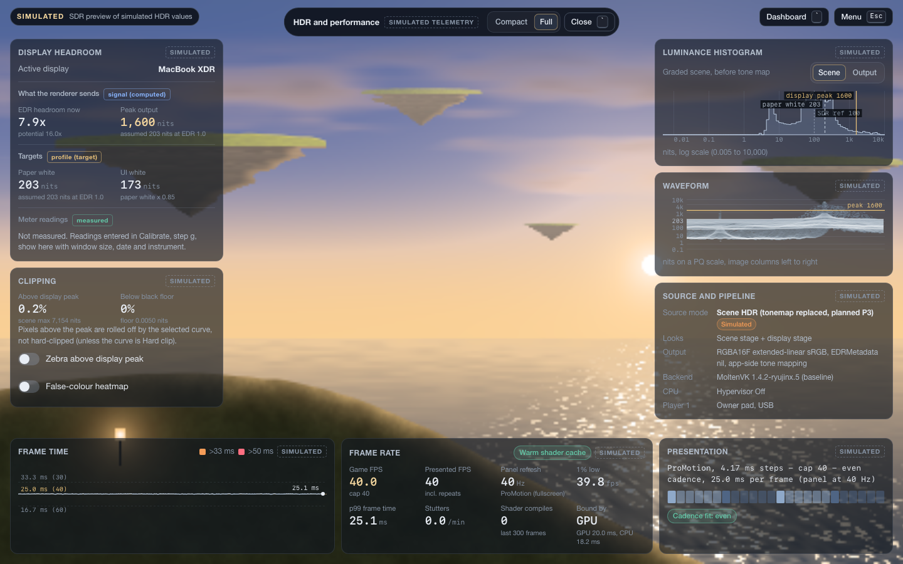
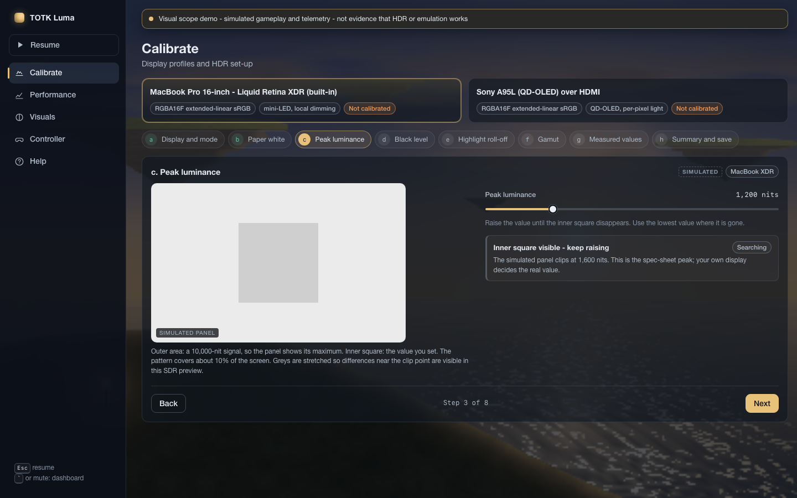
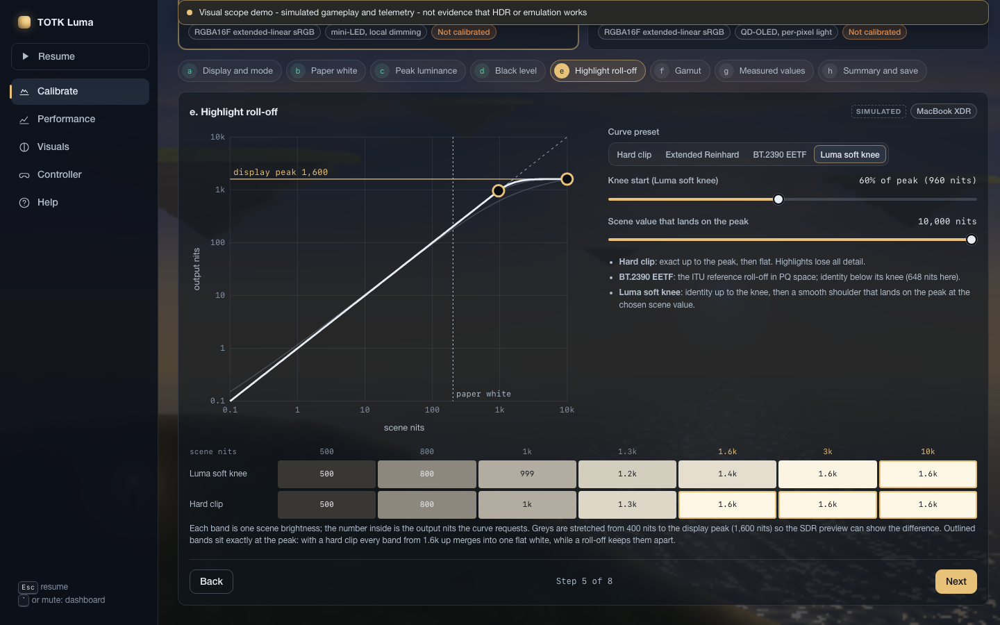
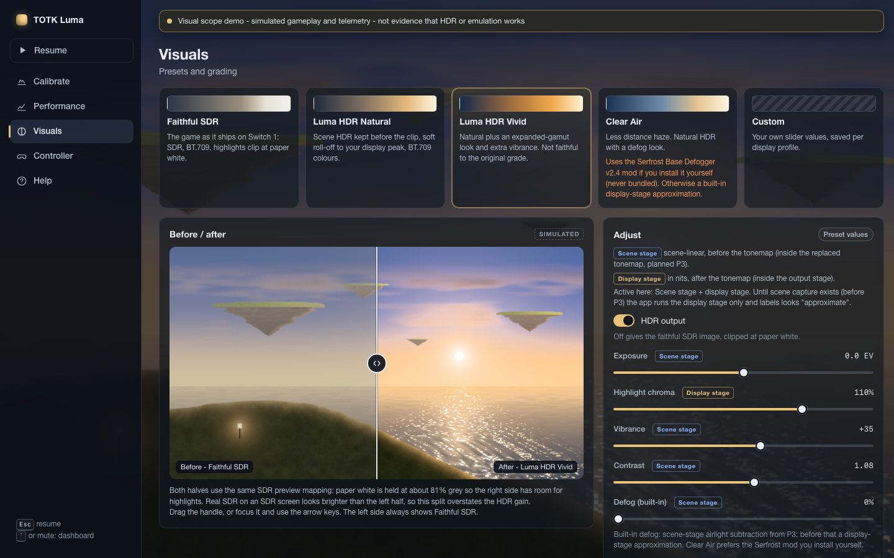
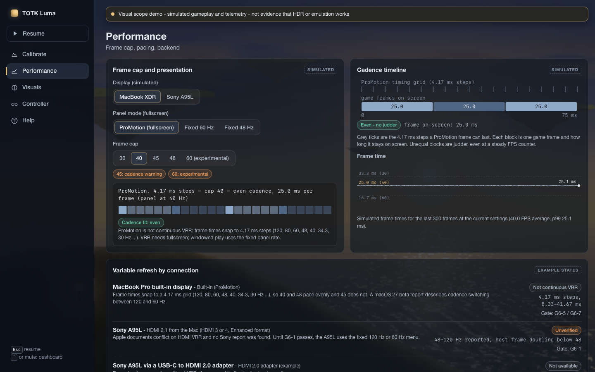
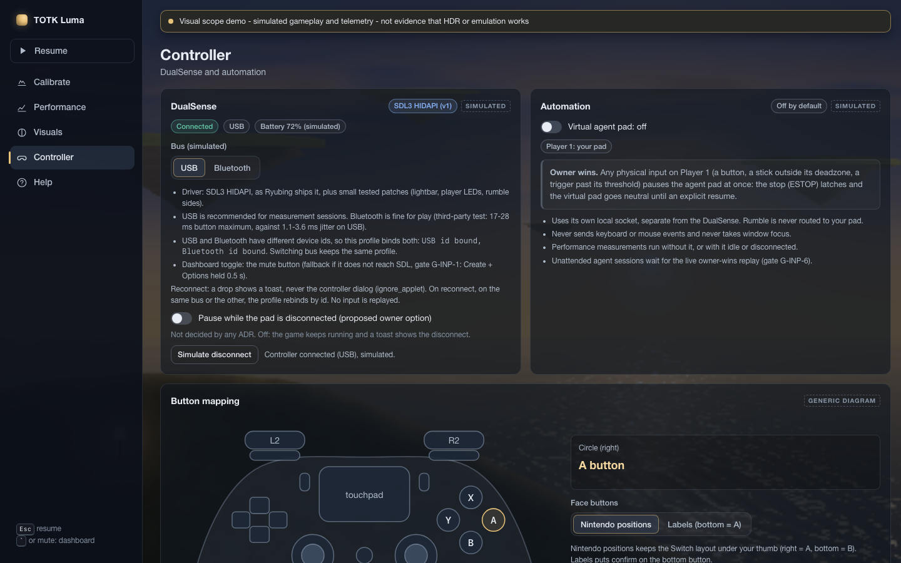
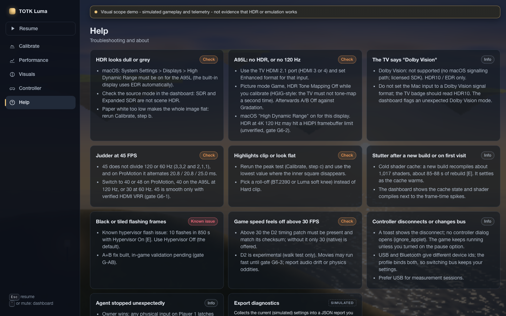

# TOTK Luma - UX specification for the fullscreen game app

Status: Proposed, 2026-11-01

This document specifies what the owner sees and touches while playing: the fullscreen default, the HDR and
performance dashboard, the calibration wizard, presets, performance settings, controller set-up, the automation
indicator, troubleshooting and accessibility.

It follows the architecture decision records in [`adr/`](adr/README.md). Where this page and an ADR disagree, the ADR
wins and the difference is a defect in this page. Nothing here authorises production emulator work; every ADR is
still awaiting owner approval.

**Conventions.**

- Evidence tags: `[D]` documented, `[M]` measured, `[I]` inferred, `[A]` anecdotal. `[E]` is the bounded prior local
  evidence in [`evidence/prior-local-evidence.md`](evidence/prior-local-evidence.md).
- Research notes are cited as "(R09 §3)" or "[R04]". ADRs are cited as "ADR 0002".
- Every effort figure is an estimate `[I]`, taken from the ADRs.
- UX choices that no ADR or note fixes are proposals, marked `[I]`, and are settled by the owner usability pass
  (G-UI-2, ADR 0002).

---

## 1. The visual-scope demo

The interactive demo in `demo/` shows the intended look and flow of this specification.

> **The demo is simulated.** The game view is an original procedural scene, every HDR value is an SDR preview in a
> browser, and all telemetry, display detection, VRR states and controller states are generated. It exists **only
> for visual-scope approval**. It is not evidence that HDR, pacing or emulation works.

| Screenshot | What it shows | Spec section |
|---|---|---|
| [`play.png`](../demo/screenshots/play.png) | Clean fullscreen default with a one-time hint | §3 |
| [`dashboard.png`](../demo/screenshots/dashboard.png) | The full dashboard over the game | §4, §5 |
| [`calibrate-peak.png`](../demo/screenshots/calibrate-peak.png) | Calibration step c, the 10 % peak test | §7 |
| [`calibrate-rolloff.png`](../demo/screenshots/calibrate-rolloff.png) | Calibration step e, highlight roll-off | §7 |
| [`performance.png`](../demo/screenshots/performance.png) | Frame cap, cadence timeline and per-connection VRR chips | §9 |
| [`visuals-split.png`](../demo/screenshots/visuals-split.png) | Presets and a before/after split | §8 |
| [`controller.png`](../demo/screenshots/controller.png) | DualSense status, mapping and the automation card | §10, §11 |
| [`help.png`](../demo/screenshots/help.png) | Troubleshooting cards | §12 |
| [`mobile-dashboard.png`](../demo/screenshots/mobile-dashboard.png) | The dashboard stacked at a narrow width | §5.1 |

### 1.1 Where the demo simplifies or differs

The demo was first built in parallel with the ADRs, then aligned with them in a second pass. These ADR behaviours are
now shown in the demo:

- the mute-button dashboard toggle;
- per-display cap menus, with no Unlocked or Unbounded cap;
- 45 FPS with a cadence warning and the 40 / 48 suggestions;
- ProMotion modelled as 4.17 ms steps;
- HDMI VRR shown only behind the G6-1 toggle;
- RGBA16F extended-linear sRGB output, and UI white at paper white x 0.85;
- the source-mode label, signal / profile / measured labels, and the Dolby Vision position;
- TV HDR Tone Mapping Off during calibration;
- a toast on controller disconnect, with pausing as an option.

Where the demo still differs, **this specification and the ADRs apply**:

| Demo shows | Specified behaviour | Source |
|---|---|---|
| Backquote toggles the dashboard | Backquote is a candidate keyboard key, accepted only if it passes the "unbound in every keyboard profile" check | ADR 0004, §4 |
| The dashboard and summary use "assumed N nits at EDR 1.0", but the calibration sliders (steps b and c) still set MacBook paper white and peak in nits | Mac values are relative EDR everywhere; nits only as "assumed N nits at EDR 1.0" | ADR 0002 D3, D9 |
| Histograms on a log-nits axis, including the scene histogram | Output scopes on a PQ axis labelled in nits; scene histogram in EV, never nits | R09 §3 |
| Roll-off presets Hard clip / Extended Reinhard / BT.2390 / Luma soft knee | BT.2390/2408 EETF default, Neutwo alternative, Hard clip option | ADR 0002 D3, R04 §3.4 |
| Continuous look sliders | Neutral default plus three fixed strengths per look | ADR 0006 §1 |
| A sidebar menu for all screens | Settings, profile and preset menus stay in Avalonia; calibration runs inside the output stage | ADR 0002 D9 |
| Dashboard states Compact and Full (closed = Hidden) | Hidden / Compact / Full / Interactive (§4.3) | §4.3 |
| Frame-time graph over 300 simulated frames, one line | 512-frame telemetry ring with guest, host and display-time series (§5.2) | ADR 0003 §3 |
| Cadence strip on ProMotion draws one block per 4.17 ms step | One block per refresh (§5.4) | §5.4 |
| No source-clip or outside-P3 counters | Both counters planned for P3 / P4 (§5.10) | ADR 0002 |
| Measured readings carry window size, date and instrument as one free-text field | Correction file recorded as its own field (§6) | R04 §3 |
| Calibration has no separate full-field peak step (c2) for the A95L | Full-field peak (MaxFFTML) step for the A95L (§7.1) | R04 §3.2 |
| Timing-patch status and reconnects shown on the Performance and Controller screens | Also as in-game toasts (§3.2) | §3.2 |
| Some Help cards are not in the demo (banding, UI too bright, ABL, stale headroom, inverted aim, PS button, rollback, source clip) | Full troubleshooting set (§12) | §12 |
| Windowed mode described in text only | Windowed mode uses the fixed panel rate menu (§3.3) | ADR 0003 §2 |
| Some status chips outside the §2.1 vocabulary ("Not continuous VRR", "Current baseline", "Gated variant", "Not planned", "Known issue", "Later phase" and others) | One chip vocabulary everywhere (§2.1) | §2.1 |

---

## 2. Design principles

1. **Clean by default.** The game fills the screen. Nothing else is drawn unless the owner asks, or a short toast has
   something actionable to say.
2. **One drawable, one owner.** The dashboard, toasts, scopes and calibration patterns are drawn by the Luma output
   stage into the game's own drawable. There is no extra window, layer or Avalonia overlay (ADR 0002 D4, D9). This
   keeps direct-to-display eligibility and never takes focus.
3. **Honest numbers.** Every number says whether it is a *signal*, a *profile* value or a *measurement* (§6). Every
   feature says whether it is verified, experimental or unverified (§2.1).
4. **SDR-safe UI.** All UI sits at or below UI white, so it never glares on a 1,000-nit panel (§5.12).
5. **Gamepad first.** Every in-game surface works with the DualSense alone (ADR 0002 D9).
6. **Never steal input.** The toggle never reaches the game. Agent automation never touches the keyboard, mouse or
   focus (ADR 0004).
7. **Zero cost when hidden.** No scope or overlay work runs while the dashboard is hidden (G-UI-1).

### 2.1 Status chips (one vocabulary everywhere)

| Chip | Meaning | Typical source of truth |
|---|---|---|
| **Verified** | Passed its gate on this display and connection | G-CAP, G6-1, G-PRES-2, G-DISP |
| **Experimental** | Works but its gate has not passed | 60 FPS until G-60; D2 until G6-4 |
| **Unverified** | Supported on paper, not yet tested here | HDMI VRR before G6-1; direct-to-display before G-PRES-2 |
| **Cadence warning** | Selectable, but the frame rate does not divide the refresh rate | 45 without verified VRR |
| **Not available** | This display, connection or build cannot do it | VRR in windowed mode; caps above 30 without D2 |
| **Withdrawn** | Failed its gate and was removed | A cap that fails G6-4 |
| **Approximate** | A display-stage look on the SDR frame, before scene HDR | Looks before P3 (ADR 0006 §2) |
| **Assumed** | A value that depends on an unmeasured constant | Mac nits; A95L N before measurement |
| **Simulated** | Demo only; never appears in the app | `demo/` |

Chips always carry text. Colour is a secondary cue (§13).

---

## 3. Default fullscreen behaviour

### 3.1 Launch

- Each variant is its own bundle with its own data root: `reference`, `measure`, `agent`, `hdr`
  (`app.totkluma.ryubing.<variant>`, ADR 0001 D10). The bundle name is shown in the dashboard, never on the game.
- On launch the game goes straight to native fullscreen on the display chosen by the active profile (`macbook-xdr` or
  `a95l`), using the standard fullscreen path (R03 implication 4) [I]. The play bundle declares `LSSupportsGameMode`
  (ADR 0003 §5). Game Mode turns on when a game enters full screen [D], but whether this bundle triggers it is
  unverified [I] (R07 verification; 02 U-30).
- The cursor hides while it is idle. No title bar, status bar or Avalonia chrome is visible in fullscreen [I].
- The display helper applies `toneMapMode = never`, the Retina `contentsScale` fix (issue #461) and the evaluated
  `preferredDynamicRange`, and re-applies them after every swapchain recreation (ADR 0002 D4). The chosen format
  and colour-space pair is written to the log at start-up.

### 3.2 What can appear without the dashboard

Only short, SDR-safe toasts, drawn by the output stage at the screen edge, auto-hiding, never taking focus [I]:

| Toast | Trigger | Source |
|---|---|---|
| "Display not calibrated: using starting values (assumed)" | First launch on a display with no saved profile | ADR 0002 G-DISP |
| "Controller connected / disconnected (USB or Bluetooth)" | SDL hotplug, replacing the controller-applet dialog | ADR 0004 (`ignore_applet`) |
| "Agent stopped: you took control" | Owner-wins ESTOP latched | ADR 0004 |
| "Timing patch missing: 30 (native) only" | D2 absent or its checksum does not match | ADR 0003 §1, §4 |
| "Cap withdrawn on this display" | A cap failed G-CAP or G6-4 | ADR 0003 |
| "Profile switched to A95L" | The game moved to another display | §3.3 |
| "Headroom may be stale" | Headroom stays at 1.0 while EDR content is on screen | R09 §3 |
| "Toggle key is bound to a player input" | Start-up toggle check failed | §4.2 |

A one-time hint names the dashboard toggle on first launch (as in `play.png`). It can be turned off.

### 3.3 Display changes

- Moving the window to another display switches to that display's profile and recomputes the cap menu (§9.1).
- After sleep and wake, the headroom is re-read; if it reads 1.0 while EDR content is on screen, the dashboard shows
  "stale?" (R09 §3) [D]/[A].
- Windowed mode is supported but treated as the fixed panel rate; VRR needs fullscreen [D] (R06 §3). Direct-to-display
  is not expected in windowed mode [D] (R03 §2).

### 3.4 Menus

Settings, profile selection and preset selection stay in Ryubing's Avalonia menus (ADR 0002 D9, ADR 0001). Opening
them while playing may leave the fullscreen game view; that path is not part of any pacing or direct-to-display
measurement [I]. The calibration wizard is the exception: it runs inside the output stage so that its patterns go
through the real swapchain path (§7).

---

## 4. Dashboard toggle

### 4.1 Bindings (ADR 0004)

| Input | Role | Leak protection |
|---|---|---|
| DualSense **mute** (`MISC1`) | Primary toggle | Removed from the guest mapping; it has no Switch equivalent [D] (R09 §4) |
| **One keyboard key** (backquote in the demo) | Keyboard toggle | Must be unbound in every keyboard player profile; checked at start-up |
| **Create + Options held 0.5 s** | Fallback if G-INP-1 shows `MISC1` does not reach SDL | Both buttons are withheld from the guest while the chord is held (R09 §4) |
| Touchpad click | Optional, if the owner chooses it | The owner then loses it as a guest input |

The PS button is never used: macOS may open Game Overlay, Games or Spotlight with it [D] (R07 §5).

### 4.2 Rules that stop leaks

- Ryubing hotkeys read the same keyboard state as emulated input, and nothing is consumed [D] (R09 §4). At start-up,
  Luma checks the toggle key against every keyboard player profile. If it is bound, the keyboard toggle is disabled
  and a toast names the conflict; the mute toggle still works [I].
- Keyboard hotkeys work only while the window is active [D] (R07 §5). The DualSense toggle works whenever the game
  reads the pad.
- With the chord fallback, the first button pressed can reach the guest before the second arrives [I]. That is why the
  mute button is preferred, and why the chord uses two buttons TOTK rarely holds together.

### 4.3 States

| State | How to reach it | Input goes to | Drawn |
|---|---|---|---|
| **Hidden** (default) | Start-up; toggle from Compact or Full | Game | Nothing; zero cost |
| **Compact** | Toggle from Hidden | Game | A single strip: FPS, frame-time sparkline, cap, cadence fit, source mode, headroom |
| **Full** | Toggle again, or chosen as the default layout | Game | All panels in §5 (`dashboard.png`) |
| **Interactive** | Hold the toggle (0.5 s, same timing as the chord) | Dashboard; the guest sees a neutral pad | Full, with a focus ring |

Toggle order and the remembered layout are proposals for G-UI-2 [I]. In Interactive, the D-pad moves focus, the
confirm button activates and the toggle exits. The game keeps running; the owner pauses it from the Avalonia menu if
wanted [I].

**OLED care.** On the `a95l` profile the dashboard dims after a few seconds without interaction, to limit retention on
QD-OLED (ADR 0002 D9, R04 §3.6).

---

## 5. Dashboard panels

### 5.1 Layout and phasing

- **Full layout:** headroom and clipping on the left, scopes on the right, frame time, frame rate and presentation
  along the bottom, as in `dashboard.png`.
- **Narrow layout:** panels stack in one column (`mobile-dashboard.png`). In the app this layout serves small windowed
  sizes [I].

| Panel | Phase | Gate |
|---|---|---|
| Frame time, frame rate, presentation, headroom, source and pipeline | P1 (dashboard core) | G-TEL, G-UI-0 |
| Cap control, D2 state, VRR state | P2 | G-CAP, G6-1 |
| Output histogram, scene histogram, source-clip counter | P3 | G-HDR-2 |
| Waveform, full clipping and gamut counters, zebra, looks status | P4 | G-UI-1, G-LOOK-2 |
| Scene-adaptive peak readout | P5, only if approved | G-DV-PEAK |

### 5.2 Frame time graph

| Property | Specification |
|---|---|
| Plots | Three series per frame: **guest** frame interval (SurfaceFlinger), **host present** interval (`vkQueuePresentKHR`), **display** interval (`actualPresentTime` differences) |
| X axis | The last 512 frames, oldest on the left (the telemetry ring size, ADR 0003 §3). That is about 17 s at 30 FPS and about 8.5 s at 60 FPS |
| Y axis | Milliseconds, linear; reference lines at the cap interval and at 16.7, 22.2, 25.0 and 33.3 ms |
| Markers | A dropped present (`actualPresentTime` 0) is a gap marker. A frame above 1.25x the target interval (the G-CAP limit) is highlighted with a shape as well as a colour. A shader-compile event is a tick on the axis |
| Source | The per-frame telemetry ring (ADR 0003 §3), never the status-bar average or the Metal HUD [E] |
| Update | Every frame |
| Before G-TEL | The display series shows "unavailable" until `VK_GOOGLE_display_timing` is confirmed on `1.4.2-ryujinx.5` |

### 5.3 Frame rate and pacing statistics

| Field | Definition | Update |
|---|---|---|
| Game FPS | Guest presents per second over the ring | 4-10 Hz (R09 §3) |
| Displayed rate | New frames reaching the display, from `actualPresentTime` | 4-10 Hz |
| Cap | The active cap and its chip (§9.1) | On change |
| p50, p90, p99, p99.9, max | Guest frame interval percentiles over the ring | 4-10 Hz |
| 1 % low, 0.1 % low | From the same ring (R09 implication 6) | 4-10 Hz |
| Jitter and cadence error rate | Error against the expected hold pattern for this cap and refresh | 4-10 Hz |
| Drops | Missed vsyncs and dropped presents | 4-10 Hz |
| Game speed | The D2 step against wall time; shown only when D2 is active | 4-10 Hz |
| Bound by | GPU or CPU, labelled as an estimate | 4-10 Hz |

The ring can be exported as CSV to the variant's private data root (ADR 0003 §3).

### 5.4 Presentation

| Field | Values |
|---|---|
| Present mode | FIFO or IMMEDIATE, as actually chosen (R09 §4) |
| Panel refresh | From the display; on ProMotion, the current interval |
| VRR | Verified / Unverified / Not available, per display and connection (§9.2) |
| Cadence fit | "even", "uneven" or "VRR", plus a hold-pattern bar: one block per refresh, a colour change per new game frame |
| Vsync source | Display link or the fallback timer (ADR 0003 §3) |
| Timed presents | On or off (`present(at:)` through `VK_GOOGLE_display_timing`) |
| Direct-to-display | "unknown" unless G-PRES-2 or G6-6 verified it for this display and mode (ADR 0002 D9) |
| LFC | Shown only with verified VRR (G6-1) |

The hold pattern uses the verified arithmetic of ADR 0003: 3,3,2 for 45 at 120 Hz; 2,1,1 for 45 at 60 Hz;
20.8/20.8/25.0 ms for 45 on ProMotion.

### 5.5 Display headroom

| Field | Label class | Source |
|---|---|---|
| Current headroom (for example "2.67x") | signal | `NSScreen` current EDR value, per frame plus the change notification (ADR 0002 D4) |
| Potential headroom ("16.0x") | signal | `NSScreen` potential value |
| Reference headroom | signal | `NSScreen` reference value; 0 means no reference rendering [D]. Whether it becomes non-zero in a reference preset is not documented [I] (R04, R09 verification) |
| "stale?" flag | signal | Headroom 1.0 while EDR content is on screen |
| Profile peak and paper white | profile | Active profile |
| Ceiling warning | signal vs profile | Profile peak above current headroom: "the system will clamp" |
| Mac SDR white | assumed | "assumed N nits at EDR 1.0", N ≈ 1600 / current headroom, valid only below the potential headroom (R04 §3.7) |
| A95L N | measured or assumed | Panel nits at EDR 1.0, from calibration (§7.2) |

The probe values above were measured once on this Mac (potential 16.0, current 2.67, reference 0.0) [M] (R03 §1.6).
They are examples, not defaults.

### 5.6 Source and pipeline

| Field | Values |
|---|---|
| Source mode | **Scene HDR**, **Expanded SDR** or **SDR**, always visible while the dashboard is open (ADR 0002 D3) |
| Looks | Scene stage, display stage, or "approximate" (display stage only, before P3) (ADR 0006 §2-3) |
| Output format | `R16G16B16A16_SFLOAT` + `EXTENDED_SRGB_LINEAR`, EDR on, `EDRMetadata` nil |
| Backend | MoltenVK `1.4.2-ryujinx.5`, or the KosmicKrisp variant if that bundle is running (ADR 0001 D2) |
| Shader cache | C0 cold, C1 Ryujinx warm and Metal cold, C2 all warm; shader compiles in the last frames |
| CPU profile | Hypervisor Off, or Hypervisor On + A+B after G-AB |
| Build | Variant, queue tag (`luma/475615f/qN`) and config hash |

### 5.7 Output histogram (P3)

| Property | Specification |
|---|---|
| Domain | Display-referred signal, after the EETF and looks, before encode |
| X axis | PQ code value (0-10,000 nits), 128 bins, labelled at 0.05, 1, 10, 100, 203, 400, 1,000 and 4,000 nits (R09 §3) |
| Y axis | Fraction of sampled pixels. A square-root scale is proposed so small highlight populations stay visible [I] |
| Reference lines | Paper white, profile peak, current EDR ceiling, black floor |
| Sampling | One pixel per 2x2 or 4x4 block, fused into the final encode pass |
| Readback | Ring of 3 host-visible buffers, 1-2 frames of latency, never waiting on the GPU (R09 §3) |
| Update | Graph every frame; numbers at 4-10 Hz |
| Label class | signal (nits through the active profile's mapping) |

### 5.8 Scene histogram (P3)

| Property | Specification |
|---|---|
| Domain | Scene-linear, before Luma's tone map; exists only with scene capture |
| X axis | log2 exposure (EV) relative to the game's mid-grey or white. **Never nits**: scene values have no absolute luminance (R09 §3) |
| Reference lines | The game's tone-map white or clip point, if known; Luma's tone-map knee |
| In SDR or Expanded SDR mode | Hidden, with "No scene data in this source mode" |

### 5.9 Waveform (P4)

| Property | Specification |
|---|---|
| X axis | Image column, left to right (256 columns) |
| Y axis | PQ, 128 bins, the same nit ticks as §5.7 |
| Modes | Luminance, or max(R,G,B) |
| Reference lines | As §5.7; the band above the profile peak is shaded |
| Implementation | Global atomics on sub-sampled pixels in a 128 KiB buffer; rendered in the next frame's overlay pass (R09 §3) |
| Update | Every frame, one frame behind |

### 5.10 Clipping and gamut counters

| Counter | Meaning | Phase |
|---|---|---|
| Above profile peak | % of sampled pixels rolled off by the EETF (not clipped, unless Hard clip is chosen) | P3 |
| **Source clip** | % of pixels at source code 254-255 in any channel: highlight data the game's own tone map already discarded | P3 |
| Below black floor | % below the profile's black floor | P4 |
| Outside P3 | % outside the panel gamut before soft compression | P4 |
| Max, mean, 99th percentile | Of max(R,G,B), in nits through the profile mapping | P4 |

Each counter shows the current value and a short history sparkline. The optional **zebra** overlay marks pixels above
the profile peak or source-clipped with static diagonal stripes; it is off by default [I].

### 5.11 Input and automation strip

Who owns Player 1 (owner pad, agent, or ESTOP latched), pad bus (USB or Bluetooth), battery, and rumble on or off
(ADR 0004). Details in §11.

### 5.12 Drawing rules for every panel (ADR 0002 D9)

- `ui_white = paper_white × UI scale`, default 0.85, range 0.6-1.0: EDR 1.0 or less on the Mac, 203 nits or less on the
  A95L.
- UI colours are converted from sRGB to linear and scaled to UI white.
- The game image under each plate is clamped to UI white; plates are at least 85 % opaque.
- Graph colours stay SDR and never use full-intensity primaries.
- Cost: estimated 0.05-0.2 ms, measured with GPU timestamps; zero while hidden (G-UI-1, G-UI-3).

---

## 6. Labelling rules

Every number in the dashboard, the wizard and the performance screen has exactly one class (ADR 0002 D9, R04 §5):

| Class | Meaning | Must show | Example |
|---|---|---|---|
| **signal** | Computed from the pixels Luma sends, through the active output transform | The assumption it depends on | "Peak 2.40 EDR (signal)" |
| **profile** | A target the owner chose or a starting value | Where it came from (owner, lab start value, standard) | "MaxTML 1,000 nits (profile, lab start value)" |
| **measured** | An instrument reading the owner entered | Instrument, correction file, window size, date | "10 % window 1,162 nits (measured, CCSS QD-OLED, 2026-11-xx)" (R04 §5 example) |

Rules:

1. **Computed rendering nits and measured panel brightness never share a field** (owner requirement; R04 Summary).
2. **Mac nits are always "assumed".** On the MacBook, EDR 1.0 is SDR white at the current brightness [D] (R09 §3).
   Nits appear only as "assumed N nits at EDR 1.0".
3. **A computed value never appears without its assumption**, for example "N = 205 nits, owner-measured on
   2026-11-xx" (R04 §5).
4. **Unmeasured fields say "not measured"**, never a default value.
5. **Scene values are never in nits** (§5.8).
6. **Units are explicit:** EDR values as plain numbers or "x" for headroom; nits only through a profile mapping.
7. **The demo marks everything "SIMULATED"**, as AGENTS.md requires. No simulated value appears in the app.

---

## 7. Calibration wizard

The wizard runs fullscreen inside the output stage. Its patterns are rendered by the stage itself, not by ImGui, so
calibration exercises the real swapchain path (ADR 0002 D9). It needs no instrument: HGIG-style "until it disappears"
tests give clip points in renderer units [D]/[I] (R04 §3.2). It is the first HDR feature to ship (P1), before any
grading work (R04 implication 2).

### 7.1 Steps (shared structure: eight steps, plus step c2 on the A95L only)

| Step | Purpose | Pattern |
|---|---|---|
| a. Display and mode | Pre-flight checklist and readouts | None |
| b. Paper white | Set game diffuse white | Paper-white match swatch |
| c. Peak luminance | MaxTML: the highest code preserved in a 10 % area | HGIG 10 % checker |
| c2. Full-field peak (A95L) | MaxFFTML: the same for 100 % of the screen | HGIG full-field checker |
| d. Black level | MinTML and near-black crush; blooming check on the Mac | Near-black PQ ramp; blooming box |
| e. Highlight roll-off | Choose the curve and check gradation | Highlight ramp with the curve plot |
| f. Gamut | Check P3 and BT.709 primaries; vivid is capped at P3 | Primary ramps |
| g. Measured values (optional) | Enter instrument readings | Same patterns at the chosen window size |
| h. Summary and save | Review every value with its label class | None |

Every step has Back and Next, works with the D-pad, and shows "Step n of 8" ("of 9" on the A95L, which adds c2; the
demo shows the eight shared steps only). Sliders move in coarse and fine steps;
the result is the **lowest value where the inner square disappears** (as in `calibrate-peak.png`).

### 7.2 MacBook XDR profile (`macbook-xdr`)

| Step | Content |
|---|---|
| a | Record the brightness setting, current, potential and reference headroom, preset (Apple XDR Display, P3-1600 nits), and the macOS build (R04 implication 8). Advise against changing brightness during the test, because a headroom change invalidates the absolute result [I] (R04 §3.2) |
| b | Paper white = EDR 1.0 × user scale (default 1.0), so game whites match the macOS UI (R04 §3.1). UI scale 0.85 (0.6-1.0) |
| c | 10 % checker; result stored as an EDR value, together with the headroom at which it was found. Starting value: the live headroom (R04 §4) |
| d | Black is 0 on a full-black field; the blooming box (small white box and HUD text on black) shows mini-LED blooming, which cannot be calibrated away. Offer the optional HUD dimming for dark scenes (R04 §3.3) |
| e | Peak target = min(live headroom, MaxTML). Curve: BT.2390/2408 EETF (default), Neutwo, or Hard clip. Explain that at headroom 1.0 the image degrades to SDR without changing mid-tones (ADR 0002 D3) |
| f | BT.709 primaries; vivid off; maximum P3 |
| g | Optional. A spectroradiometer or an HDR-rated colorimeter with a mini-LED correction; values stored as measured (R04 §3.8) |
| h | Show the "assumed SDR white" estimate (≈ 1600 / headroom) as assumed, never as measured |

### 7.3 Sony A95L profile (`a95l`)

| Step | Content |
|---|---|
| a | Checklist the owner confirms: HDMI 3 or 4; Enhanced format; picture mode Game; **TV HDR Tone Mapping Off**; Live Color and contrast enhancers off; macOS HDR on for this display; the TV's signal badge reads HDR10, **not Dolby Vision** (ADR 0005). Record the HDMI format, refresh rate and TV firmware |
| b | Paper white **203 nits on the panel** (BT.2408). This needs N, the panel nits at EDR 1.0, so EDR = 203 / N. N comes from an instrument or a visual match against a 203-nit reference; until then it is "assumed" (R04 §3.1, G-DISP) |
| c | 10 % checker; start at 1,000 nits; labs report 1,150-1,375 nits [D]/[A] (R04 Summary) |
| c2 | Full-field checker; start at 250 nits; labs report 235-255 nits. Warn that bright, large skies will trigger ABL above this value (R04 implication 4) |
| d | Near-black PQ ramp in small steps; MinTML can be 0 on OLED (R04 §3.3) |
| e | EETF to MaxTML (default) or Hard clip. Then the **TV tone mapping A/B**: Off against Gradation preferred, judged on detail, with Off kept unless Gradation is clearly better (R04 implication 3). Never stack two roll-offs (HGIG) |
| f | BT.709 in the BT.2020 container; vivid capped at P3, because the A95L covers about 99 % of P3 but only about 86-89 % of BT.2020 [D]/[A] (R04 §3.5; the 86 % figure is an unverified RTINGS extract) |
| g | Optional instrument entry with a QD-OLED spectral correction |
| h | Save with date, TV firmware, macOS build and HDMI format |

Expected time: 2-4 hours per display for an owner session, including warm-up [I] (R04 effort notes).

### 7.4 What a saved profile holds

Profile name, display, connection and HDMI format, macOS build, TV firmware (A95L), brightness and headroom at test
time (Mac), paper white, UI scale, MaxTML, MaxFFTML, MinTML, N, roll-off curve, TV tone-mapping choice, and every
measured value with its instrument metadata. Profiles live in the variant's data root, never in a public repository
(ADR 0001 D10).

**Re-calibration prompts** [I]: a new macOS build, new TV firmware, a different HDMI format, or (Mac) a large headroom
change since the test.

---

## 8. Presets and the custom look

Preset selection lives in the Avalonia menu (ADR 0002 D9). Presets are per display profile.

| Preset | Source mode | Looks (ADR 0006) | Notes |
|---|---|---|---|
| **Faithful SDR** | SDR | None | The game as it ships: SDR, BT.709, clipped at paper white |
| **Luma HDR Natural** (default once HDR exists) | Scene HDR, or Expanded SDR as the fallback tier | Neutral | Roll-off to the profile peak; BT.709 colours |
| **Luma HDR Vivid** | As above | Vivid at a chosen strength | Labelled "not faithful to the original grade"; capped at P3 |
| **Clear Air** | As above | Defog | Uses the owner-installed Serfrost Base v2.4 if present and checksum-verified; otherwise built-in defog, "approximate" before P3 |
| **Custom** | As above | Owner choices | Saved per display profile |

**Custom controls** (ADR 0006 §1):

- **Scene stage** (P3 onwards): defog strength, exposure, white balance, Oklab vivid strength.
- **Display stage**: highlight-aware chroma (ICtCp) strength; soft gamut compression to P3 is always on.
- Each look is Off or one of three strengths. Continuous sliders are not offered, so that G-LOOK-2 can test every
  setting for banding [I].
- Roll-off curve, paper white and peak belong to the calibration profile, not to presets.

**Comparing.** A held "compare" input flips instantly to Faithful SDR, using the same framing [I]. A split view, as in
the demo, is possible for display-stage looks only, because a scene-stage split would need the scene rendered twice
[I].

**Labels.** The dashboard always shows which stage is active (ADR 0006 §3). Before P3 the looks chip reads
"Approximate". Serfrost is never bundled; the preset shows "Install it yourself" if it is absent (ADR 0006 §4).

**Not in v1:** ReShade FX effects (only after P4 and G-FX), and MacShade (an optional, separate SDR experiment outside
the app) (ADR 0006 §5-7).

---

## 9. Performance settings

### 9.1 Frame cap

A cap is a guest vsync rate combined with the D2 measured-time patch (ADR 0003 §1). The menu is chosen by display and
mode; the VSync cycling hotkey becomes direct selection.

| Display and mode | Caps offered | 45 | Suggested instead of 45 |
|---|---|---|---|
| Built-in, ProMotion fullscreen | 30, 40, 48, 60 (Experimental) | Cadence warning (20.8/20.8/25.0 ms) | 40 or 48 |
| Built-in, fixed 60 Hz | 30, 60 (Experimental) | Cadence warning (2,1,1) | 30 |
| Built-in, fixed 48 Hz | 48 | Not offered (uneven) | - |
| A95L, fixed 120 Hz | 30, 40, 60 (Experimental) | Cadence warning (3,3,2) | 40 |
| A95L, fixed 60 Hz | 30, 60 (Experimental) | Cadence warning | 30 |
| A95L, VRR verified (G6-1) | 30, 45, 60 (Experimental) | Smooth; host frame doubling below the VRR floor | - |
| Any display, windowed | As the fixed panel rate | As that row | - |

**Without D2** only "30 (native)" is offered, with the toast in §3.2. With D2, Unbounded, turbo and Custom above 60 are
refused.

**Chips per cap:** Verified when G-CAP passed for this cap and display (p99 at most 1.25x the target, speed
1.00 ± 0.01, no steady-state shader spike); Experimental for 60 until G-60; Cadence warning for 45 without verified VRR;
Withdrawn if G6-4 failed. Advice beside 45: recommended only in scenes whose measured cost is 22 ms per frame or less
(R05 implication 3).

**Context, not promises.** The prior measurements with D2 at 1.2x were 44.8-50.9 FPS on the island, 38.4-45.2 under
the castle and 25.8-28.2 in the Room of Awakening; 60 was reached only in menus [E]. The screen shows this as the
reason 60 is Experimental.

### 9.2 Variable refresh by connection

One row per display and connection (as in `performance.png`), each with a chip:

- **Built-in ProMotion:** range 8.33-41.67 ms with 4.17 ms granularity [M]; cadence status set by G6-5/G6-7, which
  includes the macOS 27 beta report of ProMotion switching between 120 and 60 Hz [A].
- **A95L over HDMI:** Unverified until G6-1 (macOS offers a variable rate and the TV shows VRR active); Apple's own pages
  conflict [D]/[A].
- **Adapters or links that cannot carry VRR:** Not available.
- **DisplayPort monitor:** "Control case, not a target" (G6-9).

### 9.3 Other performance settings

| Setting | Default | Chip and note |
|---|---|---|
| Resolution scale | 1.2x (the "about 1080p" setting) | 1.0x offered as the owner's trade-off after the island A/B (ADR 0001 D2) |
| CPU profile | Hypervisor Off at 1.2x | Hypervisor On + A+B: Experimental until G-AB passes (flash rate test against 0.012 flashes/s). Prior: Room of Awakening 20.0 FPS Off against 29.4-30.8 On, with flashes [E] |
| Backend | MoltenVK `1.4.2-ryujinx.5` | KosmicKrisp appears only in its own P5 bundle, Experimental until G-KK |
| Concurrent shader compilation | Off until tested | `MVK_CONFIG_SHOULD_MAXIMIZE_CONCURRENT_COMPILATION=1` A/B (ADR 0001 D2) |
| Movies | No automatic change | Automatic 30 for movies only after G6-3; until then a note warns that movies may run fast with D2 (ADR 0003) |
| Measurement mode | Off | See §9.4 |

The shader-cache state is always visible: a new build starts cold, about 85-88 s and about 1,017 shaders [E].

### 9.4 Measurement mode

Selecting the `measurement` profile shows a read-only hygiene checklist before a run (ADR 0004, ADR 0003 §6): no-agent
build or agent pad idle; pad on USB, battery and rumble logged; no other GPU-heavy apps; Metal HUD off; power, thermal
and display state logged; same build, config hash, save and warm cache (C2 for steady-state claims). The owner starts
measured runs; agents never do. Items that the app can read are filled in automatically; the rest are owner ticks [I].

---

## 10. Controller set-up and reconnects

### 10.1 Set-up screen

| Item | Behaviour | Source |
|---|---|---|
| Status | Connected or disconnected, bus (USB or Bluetooth), battery | ADR 0004; R07 feature matrix |
| Profile binding | One owner profile binds **both** the USB and the Bluetooth DualSense ids, because the ids differ by bus [D] (R07 §1.5) | ADR 0004 |
| Mapping | Generic diagram (no Sony artwork), Nintendo positions or label positions, touchpad click mapping | Demo |
| Motion aiming | On for Player 1; deadzone 0.5, sensitivity 100 as starting values; a tilt check; axis signs confirmed by G-INP-2 | ADR 0004 |
| Rumble | Test left and right separately; the side fix ships only after the side probe | ADR 0004 |
| Lightbar and player LEDs | Per-profile lightbar colour and matching player LEDs, after the v1 patches | ADR 0004 |
| Dashboard toggle | Shows which input toggles the dashboard (§4) | ADR 0004 |
| PS button advice | "The PS button may open Game Overlay, Games or Spotlight. Do not bind it to a game action." | R07 implication 8 |
| Advanced haptics and adaptive triggers | Shown as "Not available: separate feasibility track", no controls | ADR 0004, P5 |

### 10.2 Bus guidance

USB is the default for every measurement session; Bluetooth is fine for play (ADR 0004). The screen shows a short
note: Bluetooth button latency had a 17-28 ms maximum in a third-party Windows test, against 1.1-3.6 ms jitter over
USB [D] (R07 Summary); macOS behaviour is unmeasured.

### 10.3 Permissions

No Input Monitoring prompt is expected [D] (R07 Summary), but this is unverified on macOS 27.2 beta. If a prompt
appears, the owner answers it; Luma never changes TCC settings (ADR 0004).

### 10.4 Reconnect flow

| Event | What the owner sees |
|---|---|
| Bluetooth sleep or drop | Toast "Controller disconnected"; the controller-applet dialog is suppressed (`ignore_applet`), so no window comes forward (ADR 0004) |
| Reconnect on the same bus | Toast "Controller connected (Bluetooth)"; the profile rebinds by id |
| Switch from Bluetooth to USB | Toast "Controller connected (USB)"; the same profile applies because both ids are bound |
| Second identical pad | Explicit player assignment; no dynamic "last input wins" swap (ADR 0004) |
| Agent session and physical pad disconnects | No dialog; agent state unchanged |

**Open question (not in any ADR):** should the owner profiles pause emulation while Player 1's physical pad is
disconnected, as the demo does? Proposed: an owner option, never active in `agent-background` [I].

---

## 11. Automation and the agent-pad indicator

The agent pad is a virtual gamepad on a local Unix socket. It never sends keyboard or mouse events and never takes focus
(ADR 0004; [E] §6). It exists only in the `agent` variant and is off by default.

| State | Indicator | Meaning |
|---|---|---|
| Off | Nothing | Stock SDL driver only |
| Agent idle | Small "Agent: idle" chip in the dashboard input strip | Socket configured, no input |
| Agent active | "Agent controls Player 1" chip, also shown as a small edge marker while the dashboard is hidden [I] | The owner should know before touching the pad |
| Agent-exclusive | "Agent-exclusive: physical pad masked" | Opt-in for unattended runs; drops automatically on ESTOP or socket loss |
| **ESTOP latched** | Toast "Agent stopped: you took control", then a persistent chip | Owner-wins: any non-neutral physical input latched ESTOP; the virtual pad is neutral |
| Socket lost | "Agent disconnected" | The pad goes neutral after 5 s idle or on disconnect [E] |

**Resuming** after ESTOP needs an explicit resume (ADR 0004). Proposed: the agent's control command, or a hold-to-confirm
action in Interactive mode (§4.3) [I].

**Rumble** from the virtual pad never reaches the physical pad. **Measurements** never use the agent build for strict
comparisons (§9.4). Unattended agent sessions need G-INP-6 (the live owner-wins replay) first.

---

## 12. Troubleshooting content

The Help screen holds short cards: a symptom, two or three checks, and where to fix it. Planned cards:

| Symptom | Checks | Where |
|---|---|---|
| HDR looks dull or grey | Source mode chip (SDR? Expanded SDR?); Mac headroom (near 1.0 at high brightness is expected [D], R04 Risks); macOS HDR on for the TV; TV in Game mode, HDR Tone Mapping Off; paper white too low | Dashboard §5.5-5.6; Calibrate b |
| Highlights clip or look flat | Re-run the 10 % peak test; choose the EETF instead of Hard clip; profile peak above the headroom ceiling | Calibrate c, e |
| Source clip counter is high | The game's own tone map discarded the data; only Scene HDR can recover it | §5.10 |
| Banding in skies | Lower the look strength; looks are "approximate" before P3 | Visuals |
| UI too bright or too dim | UI scale (0.6-1.0) | Calibrate b |
| Glow around HUD in dark scenes (Mac) | Mini-LED blooming; use HUD dimming | Calibrate d |
| Brightness pumps on big skies (A95L) | ABL; check MaxFFTML; keep paper white at 203 | Calibrate c2 |
| "Dolby Vision" on the TV | The Mac input must not use a DV signal format; Luma never sends DV (ADR 0005) | TV settings |
| Stutter on first visit | Cold or partly warm cache (C0/C1); a new build recompiles about 1,017 shaders in about 85-88 s [E] | Dashboard cache chip |
| Judder at 45 | Cadence warning; choose 40 or 48, or verify VRR | Performance §9.1 |
| Game speed feels wrong above 30 | D2 missing or checksum mismatch; movies may run fast until G6-3 | Performance |
| Black or tiled flashing frames | Known with Hypervisor On (10 flashes in 850 s) [E]; use Hypervisor Off | Performance §9.3 |
| Headroom shows "stale?" after sleep | Move the window or toggle fullscreen to refresh; a known class of report [A] | Dashboard |
| Controller not responding after Bluetooth switch | Both ids bound? Reconnect; check battery | Controller |
| Aim inverted with motion | Gyro axis signs; tilt check | Controller |
| PS button opened Game Overlay | System behaviour; change it in Game Controllers settings [A] (R07 §5) | macOS settings |
| Agent stopped unexpectedly | ESTOP latched by physical input; resume explicitly | §11 |
| Something broke after an update | Rollback: turn the flag off; then the previous bundle; then rebuild the previous tag (about 1 minute); then delete the build folder (ADR 0001 D10) | Help |

**Export diagnostics** writes the build manifest hash, `luma.json`, the active profile and the telemetry CSV to the
variant's private data root. It never uploads anything [I].

---

## 13. Accessibility

- **Input:** every in-game surface works with the DualSense alone; the keyboard is a full alternative in the
  Avalonia menus. The toggle can be rebound, subject to the leak check (§4.2).
- **Keyboard layouts:** the backquote key moves on non-US layouts, so the toggle key is chosen by key position or
  rebound in settings [I].
- **Not colour alone:** chips carry text; frame-time spikes carry a shape; zebra uses stripes, not colour [I].
- **Brightness comfort:** all UI sits at or below UI white; UI scale goes down to 0.6 for dark rooms (ADR 0002 D9).
  Bright full-field patterns (Calibrate c2) show a warning first and never flash [I].
- **Motion:** with the macOS "Reduce motion" setting, panels appear without animation and graphs update at the
  number rate (4-10 Hz) instead of per frame [I]. Calibration patterns are static.
- **Text size:** an overlay text-size setting, separate from the UI brightness scale [I].
- **Readability:** plates at least 85 % opaque, with the game clamped to UI white underneath (ADR 0002 D9).
- **Screen readers:** the in-drawable dashboard is not visible to VoiceOver. Every value it shows is also available in
  the exported CSV and diagnostics, and the Avalonia menus keep their own accessibility [I].
- **OLED care:** auto-dim on the A95L; no static element in the Hidden state except an active agent marker (§11).

---

## 14. Gates that sign off this UX

| Gate | What it confirms for the UX | ADR |
|---|---|---|
| G-UI-0 | ImGui pinned and reproducible, or the custom renderer (4-8 days) chosen | 0002 |
| G-UI-1 | Overlay and scopes cost 0.05-0.2 ms (estimate), measured; zero when hidden | 0002 |
| G-UI-2 | Owner usability pass of calibration on both displays, without an instrument | 0002 |
| G-UI-3 | GPU timestamps work on MoltenVK | 0002 |
| G-TEL | Frame-time graph and display series are real | 0003 |
| G-PRES-2 / G6-6 | The direct-to-display field can leave "unknown" | 0002, 0003 |
| G-DISP | Headroom, N and HDMI format per display; profiles leave "assumed" | 0002 |
| G-CAP, G-60, G6-1, G6-4 | Cap chips: Verified, Experimental, Withdrawn; VRR rows | 0003 |
| G-INP-1 | Mute toggle or chord fallback | 0004 |
| G-INP-6 | Unattended agent sessions and the agent indicator flow | 0004 |
| G-LOOK-1, G-LOOK-2 | Clear Air with Serfrost; look strengths free of banding | 0006 |

---

## 15. Open UX questions for the owner

1. Confirm the mute button plus one keyboard key as the toggle, with the touchpad click optional (ADR 0004).
2. Confirm the Hidden / Compact / Full / Interactive model and its order (§4.3).
3. Confirm UI scale 0.85 as the default (ADR 0002).
4. Pause emulation on a physical-pad disconnect in owner profiles: yes or no (§10.4)?
5. Show a small agent marker while the dashboard is hidden, or rely on the dashboard and toasts only (§11)?
6. Accept "assumed" Mac nits and computed-only labels until an instrument is available; no purchases are planned.
